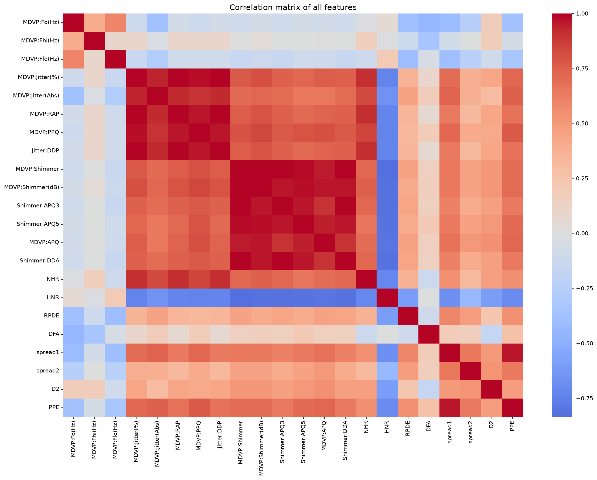
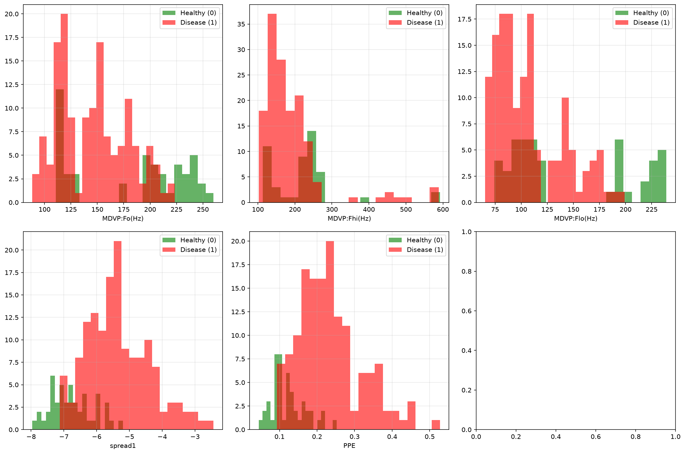
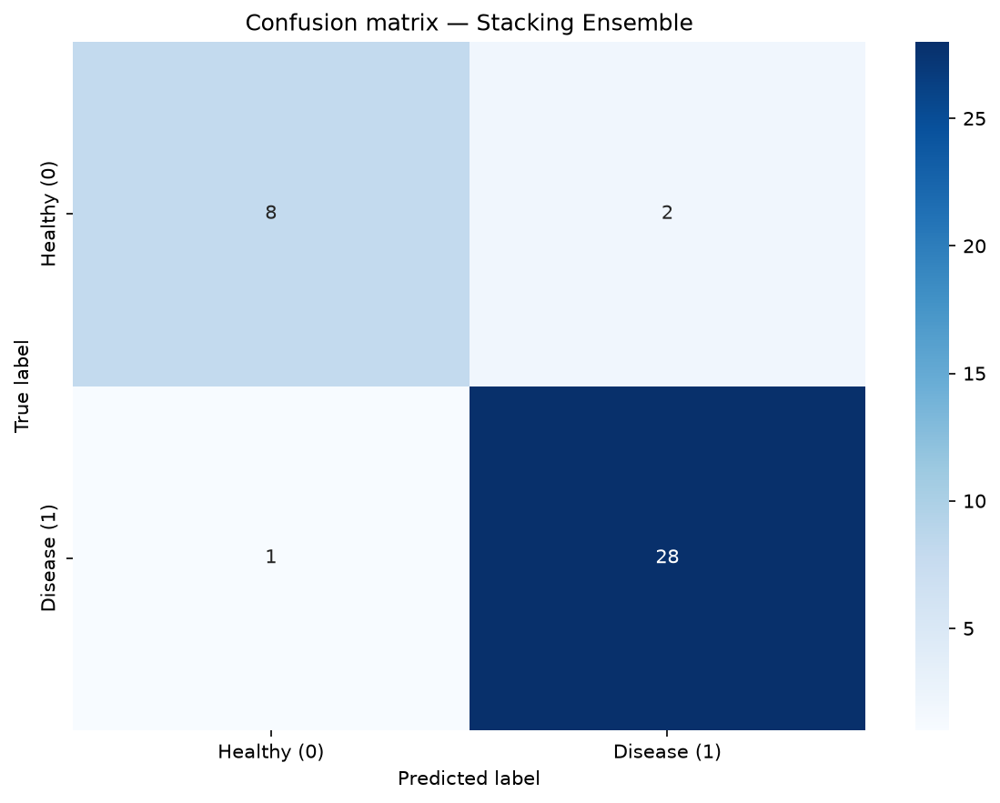

# Parkinson's Disease Detection using Machine Learning


A machine learning pipeline designed to classify voice recordings as healthy or indicative of Parkinson's Disease (PD). This project uses advanced feature engineering, dimensionality reduction (PCA), and ensemble learning (Stacking) to achieve high classification accuracy while preventing data leakage.

## 📊 Dataset

The model is trained on the **Oxford Parkinson's Disease Detection Dataset** (UCI Machine Learning Repository).
- **Instances:** 195 voice recordings
- **Patients:** 31 individuals (23 with Parkinson's, 8 healthy)
- **Features:** 23 biomedical voice measurements (e.g., frequency, jitter, shimmer, nonlinear dynamical complexity).
- **Target (`status`):** `1` for Parkinson's Disease, `0` for healthy.
- **Missing values:** None.

The dataset is derived from the study by Max Little et al. (2008). 

<details>
<summary><b>Click to view detailed Attribute Information</b></summary>

* `name` - ASCII subject name and recording number
* `MDVP:Fo(Hz)` - Average vocal fundamental frequency
* `MDVP:Fhi(Hz)` - Maximum vocal fundamental frequency
* `MDVP:Flo(Hz)` - Minimum vocal fundamental frequency
* `MDVP:Jitter(%), MDVP:Jitter(Abs), MDVP:RAP, MDVP:PPQ, Jitter:DDP` - Several measures of variation in fundamental frequency
* `MDVP:Shimmer, MDVP:Shimmer(dB), Shimmer:APQ3, Shimmer:APQ5, MDVP:APQ, Shimmer:DDA` - Several measures of variation in amplitude
* `NHR, HNR` - Two measures of ratio of noise to tonal components in the voice
* `status` - Health status of the subject (one) - Parkinson's, (zero) - healthy
* `RPDE, D2` - Two nonlinear dynamical complexity measures
* `DFA` - Signal fractal scaling exponent
* `spread1, spread2, PPE` - Three nonlinear measures of fundamental frequency variation
</details>

## 📊 Exploratory Data Analysis

Before training the models, we analyze the feature relationships and distributions.

<details>
<summary><b>Feature Correlation Matrix (Click to expand)</b></summary>
<br>

</details>

### Feature Distributions (Healthy vs. Disease)



## ⚙️ Pipeline Overview

1. **Data Splitting:** Stratified 80/20 train/test split to prevent data leakage.
2. **Multicollinearity Removal:** Highly correlated features (Pearson `|r| > 0.85`) are dropped based strictly on the training set.
3. **Preprocessing Pipeline:**
   - `StandardScaler`: Normalizes feature magnitudes.
   - `SelectKBest`: Selects top 15 features using ANOVA F-value.
   - `PCA`: Reduces dimensionality while retaining 95% of the variance.
4. **Modeling:**
   - **XGBoost:** Hyperparameter tuning via `GridSearchCV` (5-fold CV).
   - **Stacking Ensemble:** Combines XGBoost, Random Forest, and SVM using Logistic Regression as a meta-learner.
5. **Error Analysis:** Saves a CSV of misclassified instances for further review.
## 🏆 Results & Visualizations

The **Stacking Ensemble** was selected as the best model, outperforming the tuned XGBoost on the test set.

| Model | Test Accuracy |
|-------|---------------|
| Baseline XGBoost | 92.31% |
| Tuned XGBoost | 89.74% |
| **Stacking Ensemble (XGB + RF + SVM)** | **92.31%** |

### Confusion Matrix (Stacking Ensemble)


*Note: The model correctly identified 28 out of 29 disease cases (high recall).*

### Feature Correlation Matrix


*Note: The dataset is imbalanced (75.38% positive class). The model successfully maintains high recall for the disease class (0.97), minimizing false negatives.*

## 🚀 How to Run

### 1. Clone the repository
```bash
git clone https://github.com/your-username/parkinsons-ml.git
cd parkinsons-ml
```
### 2. Download the Dataset
The dataset is publicly available from the UCI Machine Learning Repository:

Primary link (new UCI format): https://archive.ics.uci.edu/dataset/174/parkinsons

Alternative (legacy URL): https://archive.ics.uci.edu/ml/datasets/parkinsons

Kaggle mirror: https://www.kaggle.com/datasets/vikasukani/parkinsons-disease-data-set

Steps:

Open one of the links above in your browser.

Download the archive (parkinsons.data or parkinsons.zip).

Extract the file and rename it to parkinsons.csv (if needed).

Place parkinsons.csv inside the data/ folder in the project root.

Your project structure should look like this:

text
parkinsons-ml/
├── data/
│   └── parkinsons.csv   <-- Place the file here
├── docs/                <-- Generated plots go here
├── parkinsons-stacking-pca.py
├── requirements.txt
└── README.md
Note: The script expects the file at data/parkinsons.csv. If you place it elsewhere, update the DATA_PATH variable at the top of parkinsons-stacking-pca.py.

### 3. Set up the environment
It is recommended to use a virtual environment:

```bash
# Windows
python -m venv .venv
.\.venv\Scripts\activate

# macOS / Linux
python3 -m venv .venv
source .venv/bin/activate
```

### 4. Install dependencies
```bash
pip install -r requirements.txt
```

### 5. Run the script
```bash
python parkinsons-stacking-pca.py
```

### 6. Outputs
The script generates the following artifacts in the project root:

parkinsons_model_<timestamp>.pkl — trained model

parkinsons_preprocessor_<timestamp>.pkl — fitted Scaler + SelectKBest + PCA

parkinsons_error_analysis.csv — misclassified instances

docs/ — plots (correlation matrix, distributions, confusion matrix)

### 📚 References
If you use this dataset or pipeline in your research, please cite:

Dataset Citation:

Max A. Little, Patrick E. McSharry, Eric J. Hunter, Lorraine O. Ramig (2008). Suitability of dysphonia measurements for telemonitoring of Parkinson's disease. IEEE Transactions on Biomedical Engineering.

Original Study:

Little MA, McSharry PE, Roberts SJ, Costello DAE, Moroz IM. Exploiting Nonlinear Recurrence and Fractal Scaling Properties for Voice Disorder Detection. BioMedical Engineering OnLine 2007, 6:23.

